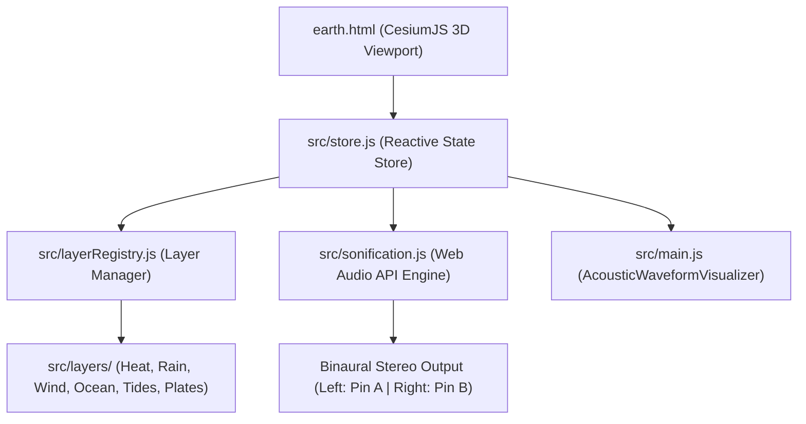

# 🌍 Thermophone: 3D Multilayer Climate & Earth Systems Globe

[](https://cesium.com/platform/cesiumjs/)
[](https://developer.mozilla.org/en-US/docs/Web/API/Web_Audio_API)
[](https://www.ncei.noaa.gov/products/land-based-station/noaa-global-temp)
[](LICENSE)

An interactive, scientifically grounded 3D planetary climate globe built with **CesiumJS** and the **Web Audio API**. Features an on-demand modular layer architecture, dual render states, natural-language voice/command parser, minimal Linear-grade comparative analytics, and real-time binaural sonification.


---

## 📂 Cloud Resources & Downloads (Google Drive)

Large raw scientific datasets (NetCDF-4 grids), supplementary audio stems, and architectural documentation are archived and downloadable:

> 🔗 **[Download Datasets & Resources on Google Drive](https://drive.google.com/drive/folders/YOUR_GOOGLE_DRIVE_FOLDER_ID?usp=sharing)**  
> *(Replace `YOUR_GOOGLE_DRIVE_FOLDER_ID` with your Google Drive share link)*

### Archive Contents:
| Resource | File | Size | Description |
| :--- | :--- | :--- | :--- |
| **NOAA GlobalTemp NetCDF** | `NOAAGlobalTemp_v6.0.0_gridded_s185001_e202512.nc` | ~21 MB | Gridded 5° global temperature anomalies (1850–2025) |
| **Tech Stack & Architecture** | `Thermophone_Earth_Tech_Stack_and_Architecture.pdf` | ~92 KB | Complete engineering tech stack and coordinating workflows |
| **Precipitation Audio** | `rain_sample.mp3` | ~2.8 MB | High-fidelity rainfall acoustics mapped to precipitation rates |
| **Combustion Stems** | `audio_sample.mp3` | ~230 KB | Procedural flame roar and thermal crackle acoustic stems |

---

## ✨ Key Features

### 1. Multilayer Comparative Analytics Panel
- **Minimal Data Design**: Engineered with strict design tokens (Linear / Apple Weather style) on an 8px grid with `backdrop-filter: blur(16px)` and zero visual clutter.
- **4-Column Metric Grid**: Compares Pin A, Pin B, and signed delta ($\Delta$) across Sea Surface Temperature (SST), Plate Speed, Wind, Rainfall, and Tides.
- **Geocoding & Ocean Identification**: Real-time reverse geocoding with fallback to named water bodies (e.g., *Arabian Sea*, *North Pacific*) instead of raw coordinates.


### 2. Dual Binaural Sonification Engine
Transforms planetary climate parameters into authentic spatial audio via the Web Audio API without synthetic alarm beeps or sirens:

- **🔥 Heat & Thermal Combustion**:
  - **Flame Roar**: Resonant pink-noise turbulent combustion ($Q = 1.8$, 80–240 Hz) with low-frequency thermal convection breathing (3–8 Hz).
  - **Ember Crackles**: Poisson-distributed micro-impulses (1.5 kHz – 4.5 kHz bandpass) scaling from 3/s (sub-zero) to 133/s (extreme heat).
  - **Musical Pentatonic Nodes**: 4-note resonant harmonic arpeggios on the C major pentatonic scale ($C_2$ sub-bass to $C_6$ crystal highs).
- **🌧️ Rainfall & Precipitation Acoustics**:
  - **Dry Land ($< 0.25\text{ mm/day}$)**: **Complete silence** ($0.0\text{ gain}$, zero audio).
  - **Light Drizzle ($0.5 - 2\text{ mm/day}$)**: Gentle, soft patter ($18\% - 30\%\text{ volume}$, $1.5\text{ kHz}$ lowpass cutoff).
  - **Torrential Storm ($\ge 14\text{ mm/day}$)**: Powerful rushing downpour ($85\% - 100\%\text{ volume}$, full $13.5\text{ kHz}$ spectrum).
- **🎧 Dedicated Binaural Stereo Channels**:
  - **Left Ear Only**: Audition Pin A exclusively.
  - **Right Ear Only**: Audition Pin B exclusively.
  - **Compare Both (L + R)**: Instantaneous spatial comparison. Placing Pin A in the Indian monsoon and Pin B in the Sahara immediately outputs heavy rain in the left ear and total silence in the right ear.

### 3. Real-Time Acoustic Waveform Oscilloscope
Visualizes acoustic waveforms in real time with high-DPI canvas rendering:
- **Pin A Waveform**: Pure pitch and droplet velocity for Pin A. Flat baseline indicates silence on dry land.
- **Pin B Waveform**: Acoustic waveform for Pin B.
- **Composite Superposition**: Live harmonic interference wave demonstrating acoustic contrast and beating frequencies.


---

## 🗺️ Layer Specifications & Data Sources

| Layer | Type | Native Units | Primary Source | Link |
| :--- | :--- | :--- | :--- | :--- |
| **Heat Map** | Raster | Anomaly in °C | NOAA GlobalTemp v6.0.0 (1850–2025) | [NOAA NCEI](https://doi.org/10.25921/9qth-2p70) |
| **Rainfall** | Raster | mm/day | GPCP v2.3 / NASA GPM IMERG | [NASA GPM](https://gpm.nasa.gov/data/imerg) |
| **Wind** | Overlay | m/s & km/h | NOAA GFS 0.25° / ECMWF ERA5 | [NOAA NOMADS](https://nomads.ncep.noaa.gov/) |
| **Ocean SST** | Overlay/Raster| °C & m/s | NASA OSCAR & NOAA OISST v2.1 | [PO.DAAC](https://podaac.jpl.nasa.gov/) |
| **Tides** | Overlay | Meters (M2 Amplitude)| CNES/LEGOS FES2014 & TPXO9 | [AVISO+](https://www.aviso.altimetry.fr/) |
| **Tectonic Plates**| Vector | mm/yr (MORVEL) | Peter Bird (PB2002) GeoJSON | [PB2002](https://github.com/fraxen/tectonicplates) |

---

## 🚀 Quick Start & Running Locally

### Option 1: Python HTTP Server (Zero Dependencies)
```bash
python -m http.server 8000
```
Open **`http://localhost:8000/earth.html`** in your browser.

### Option 2: Modern Node.js / Vite
```bash
npm install
npm run dev
```

---

## ⌨️ Controls & Natural Language Commands

### Search & Voice Command Bar
Type or speak natural language commands (e.g. via the microphone button):
- `"compare Mumbai and London"` — Drops Pin A & Pin B and opens multilayer comparison.
- `"show rainfall"` or `"enable heat map"` — Activates specified layer.
- `"fly to Tokyo"` — Animates camera smoothly to target location.

### Keyboard Shortcuts
| Key | Action |
| :--- | :--- |
| <kbd>&larr;</kbd> / <kbd>&rarr;</kbd> | Step backward / forward by 1 time step |
| <kbd>Shift</kbd> + <kbd>&larr;</kbd> / <kbd>&rarr;</kbd> | Step backward / forward by 1 year (12 months) |
| <kbd>Space</kbd> | Play / pause timeline animation |
| <kbd>A</kbd> / <kbd>B</kbd> | Place Pin A / Pin B at hovered coordinates |
| <kbd>P</kbd> | Toggle Pin Tool |
| <kbd>Esc</kbd> | Close comparison panel & active drawers |

---

## 🛠️ Architecture & Tech Stack



- **3D Geospatial Engine**: CesiumJS (WGS84 Ellipsoid, High-DPI Canvas)
- **Audio DSP Engine**: Web Audio API (BiquadFilterNode, StereoPannerNode, WaveShaper, AnalyserNode)
- **Data Ingestion**: Python (`xarray`, `numpy`, `netCDF4`)
- **UI Architecture**: Vanilla ES6 Modules, CSS Custom Properties, HiDPI Canvas Oscilloscope

---

## 📄 License

Distributed under the MIT License. See `LICENSE` for more information.
